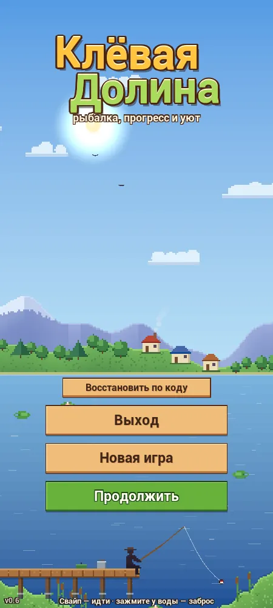
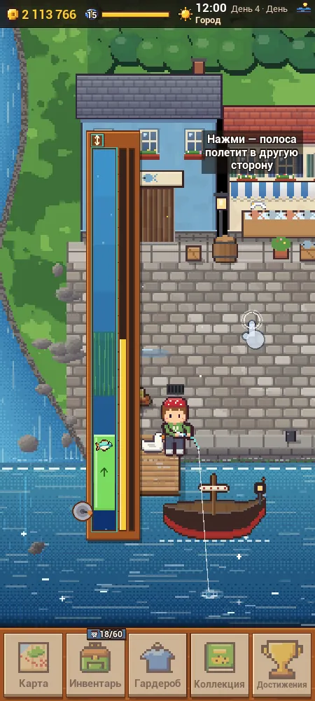
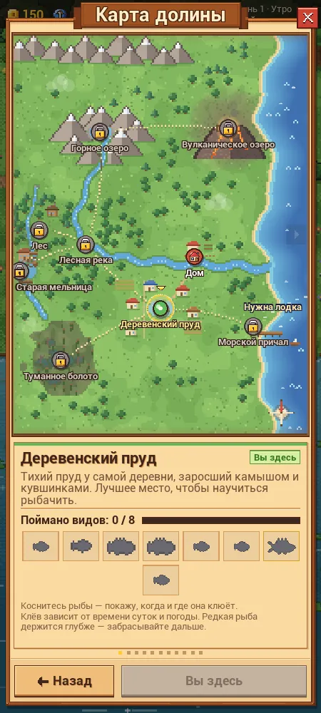
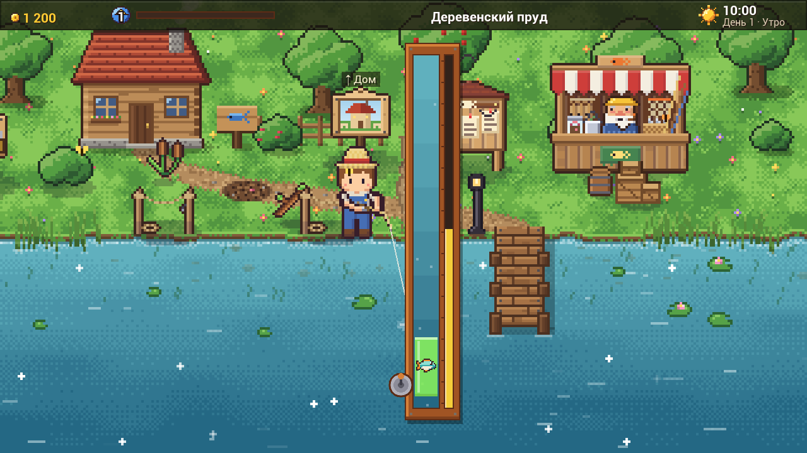

# Клёвая Долина: подробное описание

Здесь подробно описаны игра, техника, структура репозитория, сборка, ограничения и процесс разработки. Краткая версия лежит в [README](../README.md), а список рабочих документов в [Docs/README.md](README.md).

- [Что это за игра](#что-это-за-игра)
- [Технические особенности](#технические-особенности)
- [Стек](#стек)
- [Структура репозитория](#структура-репозитория)
- [Как запустить](#как-запустить)
- [Тестирование](#тестирование)
- [Состояние и ограничения](#состояние-и-ограничения)
- [Как сделано](#как-сделано)
- [Галерея](#галерея)

## Что это за игра

Игрок зажимает кнопку, чтобы набрать силу заброса, ждёт поклёвку «!» и вываживает рыбу в мини-игре, удерживая её внутри зелёной полосы. Механика вываживания повторяет BobberBar из Stardew Valley. Вокруг рыбалки построены прогрессия и мирные занятия:

- **12 мест**: девять водоёмов (пруд, лесная река, горное озеро, морской причал, болото, вулканическое озеро с ловлей в лаве, Город, Пещера, Старая мельница), а также двор, дом и лес. В данных игры **81 вид рыбы**: список генерируется в `Server/Fishing-game/lib/fish.php`.
- **Легенды**: у каждой легендарной рыбы свой бой и своя подготовка снастей. В бою бывают течение, туман, лава, рывки и обрыв поводка.
- **Экспертная рыбалка** открывается после прибытия в Город (уровни 11–15). В ней пять типов удочек: маятник, двойчатка, импульс, магнит и ползунок, и у каждого типа свой закон управления полосой.
- **Хозяйство**: двор с постройками (лесопилка, кузня, огород и другие), дом со станциями (кухня, мастерская, коптильня, аквариум и другие) и мебелью. Мини-игры: рубка, распил, ковка, готовка, копание, раскопка, вязка узлов, изготовление блёсен.
- **Косметика и коллекции**: одежда, поплавки, питомцы, коллекция рыб, достижения, учебник.
- **Окружение**: смена дня и ночи, дождь, процедурная музыка для каждой локации.
- **Онлайн**: профиль игрока, таблица лидеров, турниры каждые 3 дня с наградами в четырёх категориях, почта с подарками, резервные копии сохранений и коды восстановления. Без сервера игра работает офлайн.

## Технические особенности

- **Ноль ассетов.** Папки `Content/` в репозитории нет, а в рабочем проекте она пустая. Всё рисуется в `AHUD::DrawHUD` через собственный immediate-mode 2D-слой поверх `UCanvas` (`FVDraw.cpp`). Текстуры создаются в рантайме через `UTexture2D::CreateTransient` с фильтром `TF_Nearest`, поэтому пиксели остаются чёткими.
- **Процедурный пиксель-арт** (`FVSprites.cpp`, `FVArt*.cpp`, `FVSceneArt.cpp`): рыбы, персонаж, питомцы, здания, иконки и локации рисуются кодом по форме и палитре. Новая рыба добавляется одной записью в `FVDatabase*.cpp`, а спрайт строится сам.
- **Процедурный звук** (`FVAudio.cpp`). Звуковые эффекты синтезируются один раз при запуске в PCM 16 бит / 44,1 кГц: осцилляторы, огибающие, фильтрованный шум, щипок по Karplus-Strong. Музыка (пентатоническая мелодия, аккорды, бас, перкуссия) генерируется кусками и стримится через `USoundWaveProcedural`. Без аудиоустройства (`-nosound`) игра не падает.
- **Мини-игра на фиксированном шаге.** `FFVMinigame` содержит чистую логику без отрисовки и работает с шагом 1/60 с (`FV::SimDt`). Генератор случайных чисел детерминирован по seed, а у рыб пять типов движения. Механика повторяет BobberBar из Stardew Valley, и в комментариях кода это отмечено. Легенды берут случайные числа из отдельного потока `LegendRng`, поэтому классический бой даёт бит-в-бит тот же результат, что и эталонная таблица баланса. Автотест строит таблицы баланса ботом: 200 боёв на каждую рыбу и 300 на каждый профиль легенды.
- **Одна кодовая база для ПК и телефона.** Виртуальный холст переключается между портретом и ландшафтом. Собственный UI-кит (`FVUIKit`) даёт прокрутку с инерцией, свайп-вкладки, стек клипов и смещений. Сенсорное управление (`FVTouch.cpp`): плавающий джойстик, заброс удержанием у воды, а системная кнопка «Назад» на Android работает как Esc.
- **Онлайн-клиент** (`FVOnline.cpp`) делает асинхронные HTTP-запросы с JSON. Подписанный запрос несёт номер игрока, время по часам сервера (смещение измеряется) и одноразовый nonce, а в заголовке `X-FV-Sig` передаётся HMAC-SHA1 тела запроса. Ключ из 64 hex-символов генерируется на устройстве. Фоновые задачи (синхронизация, бэкап сохранения) выполняются по очереди. После сетевой ошибки пауза растёт экспоненциально, от 5 с до 300 с. Если сервер недоступен, игра уходит в офлайн-режим и сама возвращается, когда связь появится.
- **Распространение APK с проверкой версии.** При запуске клиент отправляет `ping` и сравнивает свой номер сборки с номерами из админки. Если сборка ниже минимальной, играть нельзя, и игрок видит кнопку «Скачать новую версию». Если она ниже последней, игра предлагает обновиться. Страница скачивания (`Server/Fishing-game/index.php`) показывает версию, список изменений и размер APK.
- **Защита сервера** (`Server/Fishing-game/lib/auth.php`, `validate.php`, `lib/db.php`):
  - подпись HMAC сверяется через `hash_equals`, время запроса допускается в окне ±1 ч, повторный nonce отклоняется;
  - rate limit: 60 подписанных запросов игрока за 10 минут, 10 регистраций и 20 попыток кода восстановления в час с одного IP, 10 неудачных входов в админку за 15 минут;
  - проверки правдоподобия: уровень соответствует опыту, счётчики не уменьшаются, не больше 40 рыб и 60 000 монет в минуту, размер рыбы не больше максимума вида. Подозрительные данные не принимаются и помечаются для админа;
  - фильтр слов в именах и статусах, баны с причиной;
  - админка: сессия с `HttpOnly` и `SameSite=Strict`, CSRF-токен проверяется на каждом POST, журнал действий;
  - `.htaccess` закрывает конфиг, `lib/`, `logs/` и базы, а в папках `download/` и `img/` запрещено выполнять скрипты.
- **Сервер на обычном виртуальном хостинге**: PHP 8 + PDO, MySQL в продакшене и SQLite для тестов. Код один, различается только DSN. Схема обновляется автоматически: `install.php` и миграция столбцов при первом запросе. Данные о рыбах и предметах для сервера (`lib/fish.php`) генерирует из C++-данных игры скрипт `Server/tools/gen_fish.php`.

## Стек

- Unreal Engine 5.8, C++ (один runtime-модуль `FishingValley`, без Blueprints), UnrealBuildTool / UAT, MSVC
- Android: arm64, Vulkan + OpenGL ES 3.1, данные внутри APK, minSdk 26 / targetSdk 34
- PHP 8 (PDO: MySQL / SQLite), HTML/CSS/JS для страницы скачивания и админки
- Batch, PowerShell и Python (Pillow) для скриптов сборки, автотестов и экспорта графики на сайт

## Структура репозитория

```
FishingValley.uproject        проект UE (модуль FishingValley, карта /Engine/Maps/Entry)
Play.bat / OpenEditor.bat      запуск игры в окне 1280×720 / открытие в редакторе
Config/                        настройки движка, Android-пакета, ввода; адрес сервера — DefaultGame.ini
Source/FishingValley/
  Public/                      «контрактные» заголовки: типы, база данных, сохранение, сцена, рыбалка, онлайн
  Private/
    FVGame*.cpp                игровой цикл, HUD, модальные окна, сохранения
    FVDraw.cpp, FVUIKit.*      2D-рендер и UI-кит поверх UCanvas
    FVTouch.cpp                жесты и сенсорное управление
    FVScene*.cpp, FVWorldU6.h  локации, большие миры с камерой, освещение, погода
    FVFishing.cpp              заброс, поклёвка, мини-игра, бои с легендами
    FVExpert*.cpp              экспертная рыбалка (типы удочек, натяжение, отрисовка)
    FVSprites.cpp, FVArt*.cpp  генератор пиксель-арта
    FVAudio.cpp                синтез звуков и музыки
    FVDatabase*.cpp            все данные игры: рыбы, места, удочки, предметы, рецепты, баланс
    FVScreen*.cpp              экраны: карта, лавки, инвентарь, гардероб, коллекция, профиль, лидеры, почта…
    FVMiniGame*.cpp            мини-игры ремёсел
    FVOnline.cpp               онлайн-клиент
    FVAutoTest*.cpp            автотест, таблицы баланса, проверка сохранений
    FVDevTools.cpp             режим разработчика (только не-Shipping сборки)
Server/
  Fishing-game/                то, что загружается на хостинг: api.php, install.php, index.php (страница
                               скачивания), admin/, lib/, download/, img/ (графика из игры для сайта)
  tests/run_tests.php          интеграционные тесты сервера
  tools/gen_fish.php           генератор lib/fish.php из данных игры
  local/config.example.php     шаблон локального конфига
Tools/                         сборка (BuildEditor, BuildAndroid), автотесты, экспорт графики; пути — в Env.bat
Build/Android/res/             иконки Android-приложения
Docs/                          спецификации обновлений, протокол API, дизайн-документ, карты кода
```

## Как запустить

### Готовая сборка

APK для Android 8.0+ (arm64) скачивается со страницы загрузки на сайте автора: <https://kostyukhinboris.ru/Fishing-game/>. Браузеру нужно разрешить установку приложений из неизвестных источников. APK подписан отладочным ключом. Эта сборка подключается к серверу автора, а если сервер недоступен, игра предложит играть офлайн.

### Сборка из исходников (Windows)

Нужны Unreal Engine 5.8 и Visual Studio Build Tools с MSVC 14.5x, Windows SDK 10.0.26100 и .NET Framework 4.8 SDK. Проект собирался именно в таком окружении, с другими версиями движка его не проверяли.

1. Откройте `Tools/Env.bat` и укажите свои пути: `UE_ROOT` (папка движка) и `FV_PROJ` (ASCII-путь, по которому скрипты будут работать с проектом). MSVC не работает с кириллицей в пути, поэтому `Env.bat` при первом запуске сам создаёт junction `FV_PROJ` на папку репозитория. Все `.bat`-файлы берут пути только из `Env.bat`.
2. `Tools\BuildEditor.bat` соберёт модуль для редактора.
3. `Play.bat` запустит игру в окне 1280×720 (F11 переключает полный экран), а `OpenEditor.bat` откроет проект в редакторе.

Полезные ключи запуска: `-fvtouch` (сенсорный режим на ПК, мышь работает как палец), `-fvserver=<адрес api.php>` или `-fvserver=off`, `-fvautotest`, `-fvshotdir=<папка в Saved>`.

Управление на ПК: WASD или стрелки — ходить; Пробел или ЛКМ (удерживать) — заброс, подсечка, подтяжка в мини-игре; E — взаимодействие; M — карта; I/Tab — инвентарь; G — гардероб; C — коллекция; J — достижения; Esc — пауза или назад.

**Автотест:** запустите `Tools\AutoTest.bat` (скриншоты сохраняются в `Saved\AutoTest`) или

```
powershell -ExecutionPolicy Bypass -File Tools\PortraitTest.ps1 -Tag mytest -Both
```

Эта команда собирает модуль, прогоняет автотест в портретном окне 450×1000, затем в ландшафтном 1280×720 и печатает сводку из лога. Окно теста должно оставаться видимым.

**Android:** установите в Unreal платформу Android, а SDK, NDK 27.2.12479018 и JDK 17 разложите по папке `FV_ANDROID` из `Env.bat` (`Sdk\`, `Sdk\ndk\<версия>\`, `jdk\`). Затем выполните `Tools\BuildAndroid.bat Shipping`, и в корне проекта появится `KlevayaDolina.apk`. В Shipping-сборке режима разработчика нет.

### Онлайн

В публичном коде адрес сервера заменён заглушкой `https://example.com/Fishing-game/` (`FV_SERVER_BASE_URL` в `Source/FishingValley/Private/FVOnline.cpp` и `ServerUrl` в `Config/DefaultGame.ini`). Поэтому сборка из исходников работает офлайн, пока вы не укажете свой сервер.

Чтобы поднять сервер локально, нужен PHP 8.2+ с расширениями `pdo_sqlite`, `mbstring` и `openssl`:

```
# интеграционные тесты: свой сервер на 127.0.0.1:8779 и чистая SQLite в Server/local/
php -n -d extension_dir=<папка PHP>/ext -d extension=pdo_sqlite -d extension=mbstring -d extension=openssl Server/tests/run_tests.php

# ручной запуск: сначала скопируйте Server/local/config.example.php в Server/local/config.php и задайте свои ключи
php -n -d extension_dir=<папка PHP>/ext -d extension=pdo_sqlite -d extension=mbstring -S 127.0.0.1:8766 -t Server/Fishing-game
#   http://127.0.0.1:8766/install.php?key=<install_key>  — создать таблицы
#   http://127.0.0.1:8766/admin/                          — админка
#   игра: UnrealEditor.exe <путь>\FishingValley.uproject -game -fvserver=http://127.0.0.1:8766/api.php
```

Известная особенность: `run_tests.php` передаёт `extension_dir` дочернему серверу без кавычек. Если PHP лежит по пути со скобками (например, `Program Files (x86)`), дочерний сервер не стартует, и все проверки падают. В этом случае запускайте PHP через путь без скобок, например через junction.

Установка на хостинг (MySQL, `config.php` из `config.sample.php`, выкладка APK и указание версии в админке) описана в [SERVER.md](SERVER.md). Протокол API описан в [UPDATE4_ONLINE.md](UPDATE4_ONLINE.md).

## Тестирование

- `Server/tests/run_tests.php` поднимает встроенный веб-сервер PHP на чистой SQLite. В 24 разделах скрипт проверяет все действия API, подписи, античит, баны, почту, коды восстановления, закрытие турнира со сдвигом серверных часов и админку. Перед этим он прогоняет `php -l` по всем PHP-файлам. При подготовке репозитория прогон на PHP 8.2 дал **806 пройденных проверок, 0 проваленных**.
- Автотест игры (`-fvautotest`) проходит экраны, подавая ввод внутрь игры (не через ОС), снимает скриншоты (в последнем ландшафтном прогоне их 182) и пишет таблицы баланса. Перед выпуском 0.6.2 он прошёл без провалов в обеих ориентациях: 321 проверка обновления 6 и 154 проверки легенд ([HOTFIX_062_RODS.md](HOTFIX_062_RODS.md)).

## Состояние и ограничения

- Версия 0.6.2 (versionCode 9) собрана 05.10.2026. Игра выпускалась только как APK на сайте автора, в Google Play её нет. Сервер работает на виртуальном хостинге автора.
- Сборка из исходников проверялась только на Windows с UE 5.8. ПК-версия запускается из редактора (отдельной Windows-сборки нет), Android-сборка только arm64, iOS нет.
- Мини-игра рыбалки повторяет механику BobberBar из Stardew Valley (константы и формулы), и в коде так и написано. Графика, звук, локации, контент и остальные механики сделаны в этом проекте.
- Мультиплеер и чат отложены, сейчас онлайн асинхронный: рейтинги, турниры, почта.
- Мелкие известные недочёты перечислены в [UPDATE6_RELEASE_NOTES.md](UPDATE6_RELEASE_NOTES.md). Некоторые файлы очень большие (в `FVFishing.cpp` и `FVScreenShop.cpp` больше 4 тыс. строк), потому что код рос быстро, по обновлениям.
- Из публичной версии убраны адрес боевого сервера (заменён заглушкой), конфиги с паролями, токен AndroidFileServer, локальные базы и логи, сборки, внутренние заметки о развёртывании, сырые отчёты агентов и handoff-промпт. В опубликованных документах остались ссылки на эти неопубликованные файлы.

## Как сделано

Проект сделан с **Claude Code**: код, документы-спецификации и тесты писали ИИ-агенты, часто несколько параллельно. Автор руководил работой. По документам в `Docs/` его роль выглядит так:

- **Постановка задач и геймдизайн.** Идеи обновлений автор описывал своими словами. Его исходные сообщения сохранены дословно, например в [UPDATE6_FOREST_CITY.md](UPDATE6_FOREST_CITY.md) (Приложение А) и [UPDATE3_UI.md](UPDATE3_UI.md) («The user's requests (verbatim)»). По ним агенты готовили спецификации.
- **Решения.** Всё, что автор решил по ходу работы, записано как «Решения владельца» Р1–Р84 в начале спецификаций и в заметках хот-фиксов (`UPDATE5_LEGENDS.md`, `UPDATE6_FOREST_CITY.md`, `HOTFIX_062_RODS.md`). Среди них экономика, прогрессия, правила рыбалки и порядок выпуска. Если вариантов было несколько, агенты оформляли предложение «на согласование владельцу» ([EXPERT_REWORK.md](EXPERT_REWORK.md)), и выбирал автор. Продуктовые рамки тоже задавал он: игра распространяется как APK со своего сайта, сервер живёт в отдельной папке на обычном хостинге и не трогает остальной сайт, мультиплеер отложен (Р13).
- **Правила работы агентов.** Процесс зафиксирован в документах:
  - у каждого агента свои файлы;
  - публичные заголовки служат замороженным контрактом;
  - исполнитель компилирует только свои файлы, а полную сборку и автотест запускает интегратор ([UPDATE_HOME.md](UPDATE_HOME.md) §0, [DESIGN.md](DESIGN.md) §1);
  - работа делится на пакеты по волнам: для обновления 6 это 37 пакетов в [UPDATE6_PACKAGES.json](UPDATE6_PACKAGES.json);
  - агенты читают карты кода ([CodeMap/](CodeMap/)), а не большие файлы целиком;
  - отчёты агентов короткие.

  Одно правило явно исходит от автора: никогда не эмулировать мышь и клавиатуру на уровне ОС, потому что он работает за этим же компьютером. Поэтому всё проверяется автотестом изнутри игры.
- **Приёмка и тестирование.** Автор играл в сборки и возвращал правки отдельными раундами: «после личной игры владельца» в `UPDATE5_LEGENDS.md`, раунд Р55–Р60 в `UPDATE6_RELEASE_NOTES.md`. Перед выкладкой в заметках хот-фикса фиксируются зелёный автотест в обеих ориентациях и проверка APK (`HOTFIX_062_RODS.md`).
- **Развёртывание и релиз.** Автор сам поднял сервер на хостинге (база данных, `config.php`, установка), загружал APK в папку скачивания и выставлял версию и список изменений в админке ([SERVER.md](SERVER.md), раздел «Выкладка» в `HOTFIX_062_RODS.md`).

Последняя сборка, 0.6.2, вышла 05.10.2026, а до неё были обновления 2–6 и два хот-фикса. Почти весь код написан агентами, поэтому проект показывает не ручной C++. Он показывает другое: как довести с ИИ-агентами большой продукт от идеи до выпущенного приложения с сервером, тестами и релизами.

## Галерея

Все картинки сняты в самой игре. Портретные кадры сделал автотест на телефонном разрешении 450×1000, ландшафтные взяты из прогона автотеста версии 0.6.2, а GIF — это запись из игры.

<p align="center">
  
  
  
  
</p>
<p align="center">
  
  
  
</p>
<p align="center">
  
  
</p>
