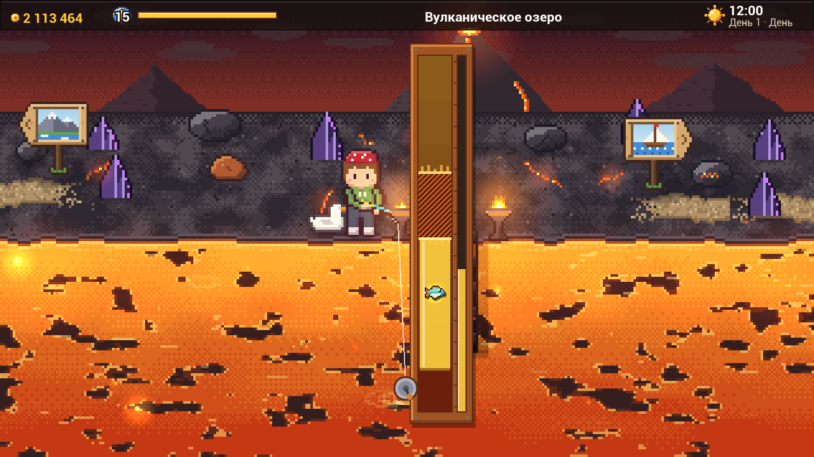
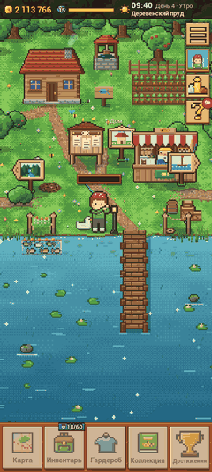
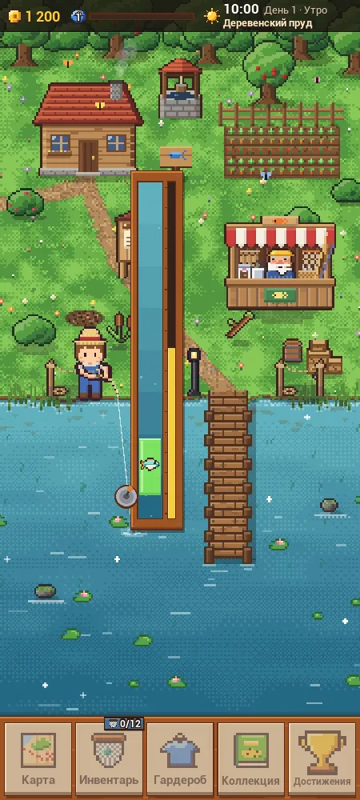
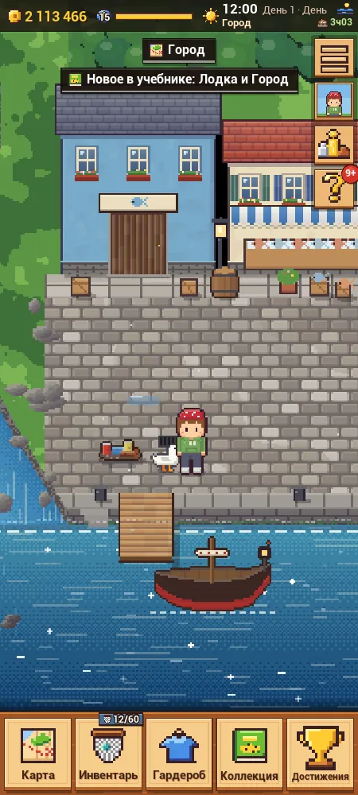
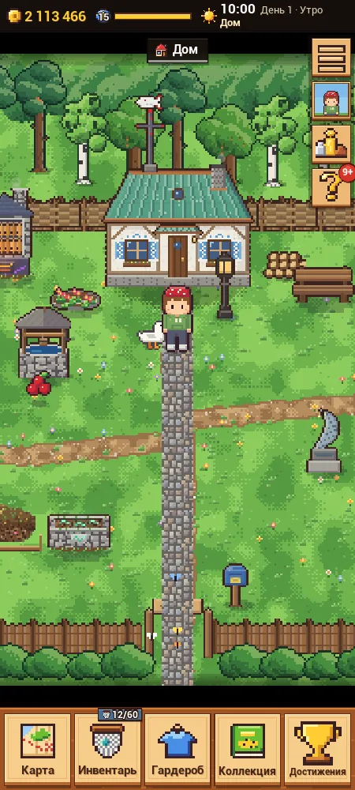
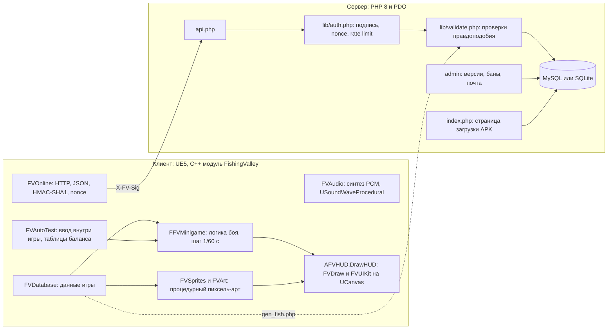

# Клёвая Долина

Пиксельная 2D-рыбалка для Android на Unreal Engine 5: ≈123 тыс. строк C++ без единого ассета, процедурные графика и звук, онлайн-сервер на PHP с турнирами и подписанными запросами.

*Pixel-art 2D fishing game for Android on Unreal Engine 5: ~123k lines of C++ with zero .uasset files, procedural art and audio, and a PHP backend with HMAC-signed requests, leaderboards and tournaments.*


**Статус:** выпущен APK 0.6.2 (versionCode 9, собран 05.10.2026). Его раздают со страницы загрузки на сайте автора, в Google Play игры нет. Онлайн-сервер развёрнут на виртуальном хостинге автора. **[Скачать APK для Android 8+](https://kostyukhinboris.ru/Fishing-game/)**

<p align="center">
  
</p>
<p align="center">
  
  
  
  
</p>
<p align="center"><sub>Кадры сняты в игре: портрет 450×1000 и ландшафт 1280×720 сделал автотест, GIF записан в игре. Остальные кадры в <a href="Docs/DETAILS.md#галерея">галерее</a>.</sub></p>

## Ключевые цифры

- **≈123 тыс. строк C++** (≈117 тыс. непустых) в одном runtime-модуле `FishingValley`: 86 `.cpp` и 33 `.h`. Файлов `.uasset`/`.umap` нет, Blueprints не используются.
- **Контент:** 81 вид рыбы, 12 локаций, 24 модуля экранов интерфейса (`FVScreen*.cpp`), бои с легендами, 5 типов экспертных удочек, мини-игры ремёсел.
- **Сервер:** 17 PHP-файлов, ≈5,2 тыс. строк вместе с тестами. Интеграционные тесты дают **806 пройденных проверок и 0 проваленных**: перепроверено при подготовке репозитория на PHP 8.2.
- **Автотест игры** перед выпуском 0.6.2 прошёл **321 + 154 проверки без провалов** в портретной и ландшафтной ориентациях ([HOTFIX_062_RODS.md](Docs/HOTFIX_062_RODS.md)).
- **Процесс:** 84 зафиксированных решения владельца (Р1–Р84) и 37 пакетов работ для агентов в обновлении 6 ([UPDATE6_PACKAGES.json](Docs/UPDATE6_PACKAGES.json)).

## Архитектура



- Клиент целиком написан на C++: мир, UI, графика и звук строятся кодом в рантайме, а кадр рисуется immediate-mode слоем в `AHUD::DrawHUD`.
- Логика вываживания (`FFVMinigame`) отделена от отрисовки и детерминирована по seed, поэтому автотест гоняет её ботом и строит таблицы баланса.
- Клиент подписывает запросы, а сервер проверяет подпись, nonce, частоту запросов и правдоподобность прогресса и только потом пишет в БД. Один и тот же PHP-код работает с MySQL в продакшене и с SQLite в тестах.
- Серверные данные о рыбах (`lib/fish.php`) генерируются из C++-данных игры скриптом `Server/tools/gen_fish.php`.

Подробности в [Docs/DETAILS.md](Docs/DETAILS.md). Протокол API описан в [Docs/UPDATE4_ONLINE.md](Docs/UPDATE4_ONLINE.md).

## Что здесь нетривиального

- **Ноль ассетов в UE5.** Спрайты рыб, персонажа, зданий и локаций генерируются кодом по форме и палитре в `UTexture2D::CreateTransient` с `TF_Nearest`. Новая рыба добавляется одной записью данных.
- **Процедурный звук:** эффекты синтезируются в PCM 16 бит / 44,1 кГц (осцилляторы, огибающие, фильтрованный шум, щипок Karplus-Strong). Музыка генерируется кусками и стримится через `USoundWaveProcedural`.
- **Детерминированная симуляция на фиксированном шаге 1/60 с** (`FV::SimDt`) с RNG по seed. Логика вываживания воспроизводит BobberBar из Stardew Valley, и в коде это отмечено. Бои легенд берут случайные числа из отдельного потока `LegendRng`, поэтому классический бой остаётся бит-в-бит воспроизводимым. Таблицы баланса строятся ботом: 200 боёв на рыбу и 300 на профиль легенды.
- **Подписанный протокол клиент-сервер:** клиент считает HMAC-SHA1 тела запроса ключом из 64 hex-символов, сгенерированным на устройстве, передаёт время по измеренному смещению серверных часов и одноразовый nonce. После сетевой ошибки пауза растёт экспоненциально (5 → 300 с), при недоступном сервере игра переходит в офлайн-режим.
- **Серверный античит без доверия клиенту:** уровень соответствует опыту, счётчики не убывают, не больше 40 рыб и 60 000 монет в минуту, размер рыбы не больше максимума вида. Подозрительные данные отклоняются и помечаются для админа.
- **Одна кодовая база для телефона и ПК:** виртуальный холст портрет/ландшафт, свой UI-кит (инерционная прокрутка, свайп-вкладки, стек клипов), сенсорное управление и принудительное обновление APK по номеру сборки из админки.

## Безопасность

- Подпись проверяется через `hash_equals` в окне времени ±1 ч, повторный nonce отклоняется. Общего секрета в клиенте нет: ключ у каждого игрока свой.
- Rate limit: 60 подписанных запросов игрока за 10 минут, 10 регистраций и 20 попыток кода восстановления в час с IP, 10 неудачных входов в админку за 15 минут.
- В админке сессия с `HttpOnly` и `SameSite=Strict`, CSRF-токен на каждом POST и журнал действий. `.htaccess` закрывает конфиг, `lib/`, `logs/` и базы, а в `download/` и `img/` скрипты не выполняются.
- В публичном коде боевой адрес сервера заменён заглушкой `https://example.com/Fishing-game/`. Конфиги с паролями не публикуются, вместо них лежит шаблон `Server/local/config.example.php`.

## Запуск

Серверные тесты (PHP 8.2+ с `pdo_sqlite`, `mbstring`, `openssl`) поднимают сервер на `127.0.0.1:8779` с чистой SQLite:

```sh
php -n -d extension_dir=<папка PHP>/ext -d extension=pdo_sqlite -d extension=mbstring -d extension=openssl Server/tests/run_tests.php
```

Игра на Windows (UE 5.8, MSVC). Сначала пропишите пути в `Tools\Env.bat`:

```bat
Tools\BuildEditor.bat
Play.bat
Tools\BuildAndroid.bat Shipping
```

`BuildEditor.bat` собирает модуль, `Play.bat` запускает игру в окне 1280×720, а `BuildAndroid.bat` собирает `KlevayaDolina.apk`. Сборка из исходников работает офлайн, пока в `Config/DefaultGame.ini` не указан свой сервер. Автотест, локальный сервер, Android SDK/NDK и установка на хостинг описаны в [Docs/DETAILS.md](Docs/DETAILS.md#как-запустить) и [Docs/SERVER.md](Docs/SERVER.md).

## Как сделано

Игру сделали ИИ-агенты Claude Code, часто несколько параллельно, под руководством Бориса Костюхина. Он ставил задачи и придумывал геймдизайн, принимал продуктовые и архитектурные решения (84 «Решения владельца» в спецификациях) и задал правила работы агентов: владение файлами, замороженные заголовки-контракты, сборка и автотест у интегратора, карты кода вместо чтения больших файлов ([DESIGN.md](Docs/DESIGN.md) §1, [UPDATE_HOME.md](Docs/UPDATE_HOME.md) §0). Сборки он принимал после собственной игры, раундами правок, а сам развернул сервер на хостинге и выпускал APK с версиями через админку. Рабочие документы собраны в [Docs/](Docs/README.md).

---

Борис Костюхин · [kostyukhinboris.ru](https://kostyukhinboris.ru) · Telegram [@boris_BF](https://t.me/boris_BF)
